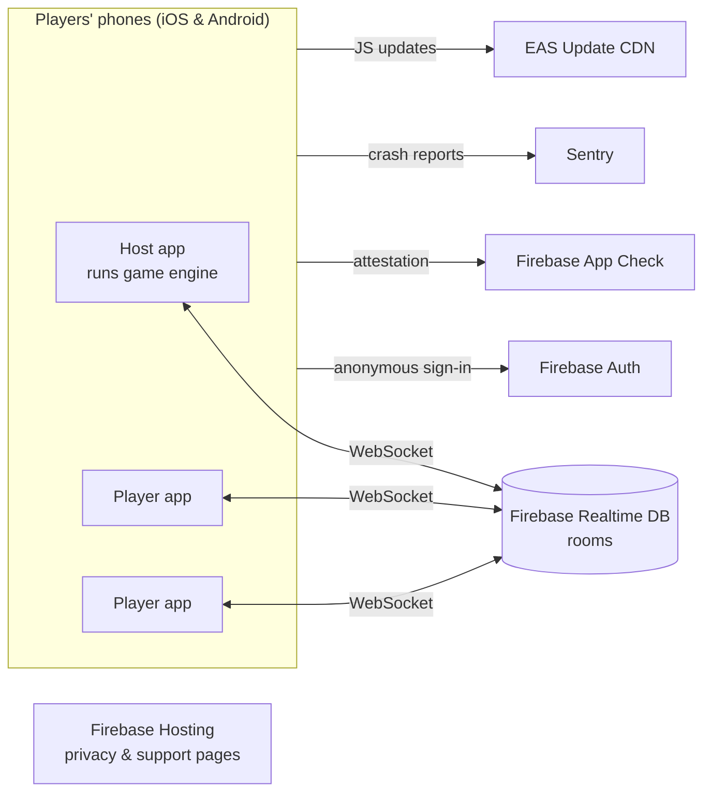
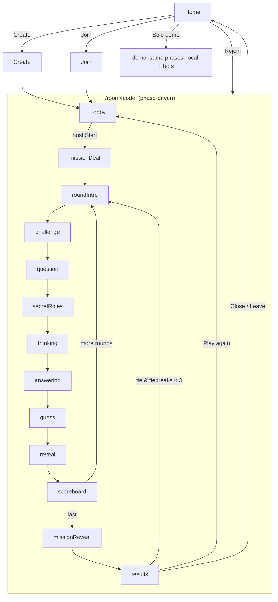

# Architecture: حالتيتا (Haltita)

> **Status:** v3.0 (production-ready plan) · **Last updated:** 2026-10-03
> This file covers HOW the app is built and run in production: system design, stack, data, security, cloud, CI/CD, observability and scaling. For what we build, see `prd.md`. For AI coding rules, see `rules.md`.

## 0. Coverage index

| # | Area | Section |
|---|---|---|
| 1 | System design | §1, §4 |
| 2 | System architecture | §2, §3 |
| 3 | Frontend | §3, §5, `design.md` |
| 4 | APIs and backend logic | §4, §6 |
| 5 | Database and storage | §7, §8 |
| 6 | Authorisation and permissions | §9 |
| 7 | Hosting and cloud | §10 |
| 8 | CI/CD and version control | §11 |
| 9 | Security | §12 |
| 10 | Rate limiting and abuse | §13 |
| 11 | Caching and CDN | §14 |
| 12 | Error tracking and logs | §15 |
| 13 | Monitoring and alerts | §16 |
| 14 | Testing | §17 |
| 15 | Scaling | §18 |
| + | Store release and compliance | §19 |

---

## 1. System design (overview)



- **Serverless, host-authoritative.** There is no backend server to write or run. The **host's phone runs the game engine**. Other phones send **intents** and render what the host publishes. Firebase Realtime Database (RTDB) is the shared, real-time "table".
- **Why:** $0 running cost, no server to maintain, real-time sync built in, and secrets stay off other players' phones through per-player database nodes.
- **Accepted trade-off:** a tampered host app could cheat. That's acceptable for a game among friends. The upgrade path, if it's ever needed, is a server-authoritative game server (§18).
- **Solo demo mode** runs the same engine **entirely on one phone** with simulated players and no network. It exists for store reviewers and for development.

## 2. Tech stack

| Layer | Choice | Why |
|---|---|---|
| Platforms | **iOS + Android from one codebase** | Both stores at launch |
| Framework | **Expo (React Native), latest stable SDK**, managed workflow, **development builds** (`expo-dev-client`) | Easiest cross-platform route; EAS builds iOS in the cloud with no Mac needed. Expo Go is used only in the early phases |
| Language | TypeScript, `strict: true` | Safety for rules and scoring |
| Navigation | Expo Router | File-based, few routes |
| Backend | **Firebase Realtime Database** (JS SDK) | Real-time sync; free Spark plan |
| Auth | **Firebase Anonymous Auth** (JS SDK) with AsyncStorage persistence | No sign-up friction; a stable uid gives rejoin |
| App attestation | **Firebase App Check**: `@react-native-firebase/app-check` (Play Integrity / App Attest) bridged into the JS SDK through `CustomProvider` | Only genuine app builds can reach the database |
| Local state | Zustand (+ `persist` for settings and last room) | Small and readable |
| Game logic | Pure TypeScript engine (`src/engine`) | Runs on the host (online) or locally (demo); fully unit-tested |
| UI | React Native `StyleSheet` + theme tokens, Reanimated, Gesture Handler, react-native-svg | Performance and art |
| Fonts | `@expo-google-fonts/lalezar`, `@expo-google-fonts/cairo` (bundled in the app) | Arabic identity, no runtime download |
| Device | expo-haptics, expo-audio, expo-keep-awake, expo-crypto, expo-localization | Feedback, wake lock, seeds, locale |
| Crash/error tracking | **Sentry** (`@sentry/react-native` + Expo config plugin) | Crash and error alerts with source maps |
| OTA updates | **EAS Update** | Ship JavaScript-only fixes without a store review |
| Builds and submission | **EAS Build + EAS Submit** | Cloud builds and uploads to App Store Connect and Play Console |
| CI | **GitHub Actions** | Tests on every push; tag-driven releases |
| Static web | **Firebase Hosting** | Privacy policy and support pages (required by both stores) |
| Tests | jest-expo, @testing-library/react-native, Firebase Emulator Suite + @firebase/rules-unit-testing | Engine, UI, security rules |

## 3. Folder structure

```
haltita/
├─ app/                              # Expo Router routes (thin)
│  ├─ _layout.tsx                    # fonts, i18n/RTL, auth, Sentry, ErrorBoundary, connection banner
│  ├─ index.tsx                      # Home: create / join / rejoin / solo demo
│  ├─ create.tsx  join.tsx           # room entry
│  ├─ room/[code].tsx                # online room: lobby or game (phase-driven)
│  ├─ demo.tsx                       # solo demo (local engine + bots)
│  ├─ rules.tsx  settings.tsx  about.tsx   # about = privacy/support links, version
├─ src/
│  ├─ engine/                        # pure logic: types, reducer, scoring, deck, rng, errors, project
│  ├─ content/                       # content.json (v3.1) + typed loader/validation
│  ├─ firebase/                      # app.ts, appCheck.ts, paths.ts, rooms.ts, presence.ts, janitor.ts
│  ├─ room/                          # GameSync interface, HostRunner, FirebaseSync, DemoSync (+bots), useRoom
│  ├─ features/lobby/  features/game/phases/
│  ├─ components/ui/  components/art/
│  ├─ theme/  i18n/
│  └─ lib/                           # haptics, sound, storage, formatNumber, logger (Sentry wrapper), net
├─ firebase/                         # database.rules.json, firebase.json, hosting/public (privacy, support)
├─ .github/workflows/                # ci.yml, release.yml
├─ docs/                             # prd, architecture, rules, design, tasks, memory, assets/
├─ app.config.ts  eas.json  tsconfig.json  jest.config.js  .env.example
```

**Layering:** `app/` → `features/` → `components/` → `room/` → `firebase/`, `engine/`, `content/`, `lib/`. Imports only go downward. `engine/` imports nothing from the app.

## 4. Application flow



- Rendering is derived from `phase`. Phase components never navigate; they only send intents.
- **`GameSync` interface** with two implementations:
  - `FirebaseSync` (online): intents go through RTDB and the host runs `HostRunner`.
  - `DemoSync` (solo): the reducer runs locally, and **bots** send `READY_*` after 1–2 s and pick a random player when they are the guesser.

  Phase components are identical for both.

## 5. Frontend notes

- Arabic-first with forced RTL and an English toggle (`src/i18n`). Fonts are bundled.
- Secret screens use `HoldToReveal`, which hides on release, on background and on blur.
- The app connects to Firebase **only while inside a room** (`goOnline` on room enter, `goOffline` on leave). This saves connections (§18).
- `expo-keep-awake` is active on `/room/*` and `/demo` only.
- Web (Expo web) stays compatible for **development testing only** (multiple browser tabs as players). It isn't shipped.

## 6. Backend logic (host-authoritative)

```
Player UI ─sendIntent()─▶ rooms/{code}/intents/{id} ─▶ HostRunner (host phone)
                                                          │ validate actor + phase + payload
                                                          │ engine.reducer(state, action)
useRoom() ◀─ public, private/{uid} ◀── one atomic multi-path update ◀─┘ (+ hostState)
```

- **Actions, actors and phases:** see §6.1. The host's own UI uses the same intent path.
- Invalid intents are deleted, nothing else is written, and the sender's `members/{uid}/lastError` is set (shown as a toast).
- **Host resume:** `hostState` is stored in RTDB, so a restarted host app reloads it and continues.

### 6.1 Actions

| Action | Phase | Sent by | Effect |
|---|---|---|---|
| `START_GAME` | lobby | host | Validate (4–8 players, punishment set), build decks, deal missions, lock the punishment |
| `KICK_PLAYER {uid}` | lobby | host | Remove a member before start (moderation) |
| `READY_MISSION` | missionDeal | self | All ready → roundIntro |
| `BEGIN_ROUND` | roundIntro | host | Draw challenge, question, truth-holder |
| `NEXT` | challenge, question, answering, reveal | host | Advance; entering thinking sets `thinkEndsAt` |
| `READY_ROLE` | secretRoles | self (answerers) | All ready → thinking/answering |
| `FORCE_READY` | secretRoles, missionDeal | host (after 20 s) | Advance anyway |
| `TIMER_DONE` | thinking | host | → answering |
| `TOGGLE_PENALTY {uid}` | answering | host | −1 toggle (never the guesser) |
| `SUBMIT_GUESS {uid}` | guess | guesser (host if the guesser is disconnected) | Score → reveal |
| `CONTINUE` | scoreboard | host | → next round / missionReveal / results |
| `SET_MISSION_RESULT` | missionReveal | host | +3 when done; then results / tie-break |
| `END_EARLY` | in game | host | → missionReveal / results |
| `PLAY_AGAIN` | results | host | → lobby |

There are **no skip or redraw actions** for challenges or missions (`prd.md` §7.6).

## 7. Database design (RTDB)

```
rooms/{code}/                                   code = 5 digits, Western numerals
  meta:      { hostUid, createdAt, status: 'lobby'|'playing'|'ended', contentVersion, hostLastSeen, appVersion }
  members/{uid}: { name, connected, lastSeen, lastIntentAt, lastError? }
  lobby:     { settings, punishment: {id? | customText?}, seatOrder: [uid] }
  public:    { phase, roundIndex, totalRounds, isTiebreak, players[{id,name,seat,masks,connected}],
               guesserId, answerOrder, challengeId, questionId, thinkEndsAt?, readyCount,
               penalties, reveal?, missionReveal?, result? }
  private/{uid}: { missionId?, role?: 'truth'|'liar'|'guesser', questionId? }
  intents/{pushId}: { uid, type, payload, at }
  hostState: GameState                                          (host only)
hosts/{uid}: { usedQuestionIds: { q042: true … }, lastRoomAt }
```

- **Projections** (`engine/project.ts`): `public` never contains secrets before their reveal phase, and `private/{uid}` only contains that player's data. Both are unit-tested.
- **Room size:** about 10–20 KB, deleted after the game.

## 8. Storage and data lifecycle

| Data | Where | Retention |
|---|---|---|
| Game content (questions etc.) | Bundled in the app (`content.json`) | Updated with app releases or EAS Update |
| Rooms | RTDB | Deleted by the host on Close. Otherwise deleted by the **janitor** after 24 h |
| Question history | RTDB `hosts/{uid}` | Kept; reset automatically when the pool runs low |
| Auth identity | Firebase Auth (anonymous) + AsyncStorage on the device | Until the app is uninstalled or "reset my data" is used |
| Settings, last room | AsyncStorage | On device |
| Crash reports | Sentry | 30-day retention (Sentry default for the free plan; confirm at setup) |

- **Janitor (free, no Cloud Functions):** when a room is created, the client queries up to 10 rooms with `meta/createdAt` older than 24 h and deletes them. The rules allow anyone to delete a room only if `createdAt < now − 24h`.
- **Reset my data** (Settings): deletes `hosts/{uid}`, signs out the anonymous user, and clears AsyncStorage. This is good privacy practice, and Apple reviewers look for it.
- **No backups needed:** all server data is temporary game state.

## 9. Authorisation and permissions

- **Identity:** Firebase Anonymous Auth. Player ID = `uid`.
- **Roles:** *host* (`meta.hostUid`), *member* (has `members/{uid}`), *self* (own `private/{uid}`). Security rules (§12.2) enforce them, and the HostRunner enforces them again for every action.
- **Device permissions:** **none requested.** No camera, microphone, location, contacts or notifications. Sharing the room code uses the system share sheet, which needs no permission.
- **App Check:** enforced on RTDB in production. There's a debug provider for development builds and CI (the debug token is stored as a secret).

## 10. Hosting and cloud

| Resource | Dev | Prod |
|---|---|---|
| Firebase project | `haltita-dev` (Spark) | `haltita-prod` (Spark; Blaze when needed, §18) |
| RTDB location | `europe-west1` (chosen at creation, **can't be changed**) | `europe-west1` |
| Firebase Hosting | — | `haltita-prod.web.app/privacy`, `/support` |
| Sentry project | `haltita` (environment `development`) | `haltita` (environment `production`) |
| Expo / EAS | One Expo account, project `haltita` | Update channels: `preview`, `production` |
| Stores | — | App Store Connect + Google Play Console (personal accounts) |

- **Config:** `app.config.ts` reads `APP_ENV` (`development`, `preview`, `production`) and selects the Firebase config, Sentry environment and bundle ID suffix (`.dev` for development builds, so dev and prod apps can sit side by side).
- **Secrets:** EAS environment variables plus GitHub Actions secrets. Nothing is committed. `.env.example` lists the names only:
  - `EXPO_PUBLIC_FIREBASE_*` (all `EXPO_PUBLIC_` values end up inside the app; they are identifiers, not secrets)
  - `SENTRY_AUTH_TOKEN` (build-time only)
  - `EXPO_TOKEN`
  - `APPCHECK_DEBUG_TOKEN`

## 11. CI/CD and version control

- **Repo:** private GitHub repository `haltita`.
- **Branches:** `main` is always releasable. Work happens on task branches `t/<task-id>-<slug>` and merges into `main` through a pull request. The owner merges after CI passes.
- **Commits:** `T<id>: <summary>` (one task = one commit or PR).
- **Versioning:** `version` follows semver (1.0.0). Build numbers increment automatically through EAS (`autoIncrement`). `runtimeVersion` uses the `appVersion` policy for EAS Update compatibility.

| Workflow | Trigger | Steps |
|---|---|---|
| `ci.yml` | Every push or PR | install → `tsc --noEmit` → lint → `jest` → Firebase emulator rules tests → `npm audit --audit-level=high` |
| `release.yml` | Git tag `v*` | `eas build --platform all --profile production --non-interactive` → `eas submit` (iOS → TestFlight, Android → Play internal track) |
| OTA (manual) | Owner runs it | `eas update --channel production` for JavaScript-only fixes. Native changes always need a new build |
| Rules deploy | Manual, after rules tests pass | `firebase deploy --only database,hosting -P prod` |

- **Dependabot** is enabled for npm security updates (weekly).
- **EAS profiles** (`eas.json`):
  - `development`: dev client, internal distribution
  - `preview`: internal APK / ad-hoc iOS for testers
  - `production`: store builds

## 12. Security

### 12.1 Principles

- Least privilege in rules; secrets never reach other players' devices; App Check on; no personal data beyond a display name; HTTPS/WSS only (Firebase default).

### 12.2 Security rules (outline; full rules in `firebase/database.rules.json`)

| Path | Read | Write / validate |
|---|---|---|
| `rooms/{code}/meta` | members | Create only if absent, with `hostUid == auth.uid`, plus a creation throttle (§13). Status changes by the host. Delete by the host, or by anyone if `createdAt < now − 24h` |
| `members/{uid}` | members | Self only. Join only if `status == 'lobby'` and fewer than 8 members (rejoin always allowed). `name` is a string of 1–16 chars |
| `lobby` | members | Host, `status == 'lobby'` only. `customText` ≤ 80 chars |
| `public` | members | Host only |
| `private/{uid}` | **that uid only** | Host only |
| `intents/{id}` | host | Member, `uid == auth.uid`, `at == now`, payload ≤ 200 bytes, plus an intent throttle (§13) |
| `hostState` | host | Host |
| `hosts/{uid}` | self | Self |

### 12.3 Threats and mitigations

| Threat | Mitigation |
|---|---|
| Scripted clients spamming the database | App Check + rules throttles + size validation |
| A player reading others' roles | Per-uid `private` nodes; projection leak tests; rules tests |
| A stranger guessing a room code | Codes expire with the room (24 h max); the host can **kick** in the lobby; no joining after start |
| Offensive names or custom punishments | Visible only to people in that room; length limits; the host can kick. A basic Arabic/English profanity filter on names and custom punishments (local list) |
| Leaked keys | No real secrets in the app; `EXPO_PUBLIC_*` values are public identifiers protected by rules and App Check |
| Vulnerable dependencies | `npm audit` in CI + Dependabot |
| Cheating host | Accepted risk (friends' game); documented |

## 13. Rate limiting and abuse protection

There's no server, so limits are enforced in **security rules** plus App Check.

| Limit | Rule |
|---|---|
| Room creation | One per uid per 60 s (`hosts/{uid}/lastRoomAt` is written in the same update and must be older than 60 s) |
| Intents | One per uid per 250 ms (`members/{uid}/lastIntentAt` is updated with each intent) |
| Payload sizes | Names ≤ 16 chars, custom punishment ≤ 80, intent payload ≤ 200 bytes |
| Members per room | ≤ 8 |
| Client-side | Buttons disabled while an intent is pending; join retries back off |
| Platform | Firebase's own per-database limits (write throughput, connections) |

## 14. Caching and CDN

- **No custom CDN is needed.** All content, fonts, images and sounds are **bundled in the app binary**, so there are no runtime downloads.
- **JavaScript updates:** EAS Update serves update bundles from Expo's CDN.
- **Web pages:** Firebase Hosting serves the privacy and support pages from Google's CDN.
- **Data:** RTDB keeps live data in memory on the client; there's no disk persistence (game state is temporary). The content loader parses `content.json` once at startup.

## 15. Error tracking and logs

- **Sentry** in all builds (environment-tagged), with **source maps** uploaded during EAS Build so stack traces are readable.
- **Captured:** JavaScript errors, native crashes, unhandled promise rejections, `GameError`s reported by HostRunner (code only), and Firebase write failures.
- **Breadcrumbs:** phase changes, intent **types** and connection changes.
- **Privacy:**
  - `sendDefaultPii: false`
  - never attach names, roles, mission or question IDs, or room codes (scrubbed in `beforeSend`)
  - the anonymous `uid` is hashed before attaching
- **Logger:** `lib/logger.ts` wraps the console in development and Sentry in production. There are **no raw `console.log` calls** in the app code.
- **Release health:** crash-free sessions per release, tied to `version` and build number.

## 16. Monitoring and alerts

| What | Tool | Alert |
|---|---|---|
| New crash or error type | Sentry | Email on every **new issue**, plus a spike alert (more than 20 events per hour) |
| Crash-free sessions < 99% | Sentry release health | Weekly check before promoting a release |
| RTDB simultaneous connections | Firebase console → Usage; Cloud Monitoring alert at **80** (verify availability on Spark at setup; otherwise a weekly manual check) | Email |
| RTDB storage and download | Firebase usage tab | Monthly check |
| Store vitals (crashes, ANRs, ratings) | Play Console and App Store Connect | Weekly check after launch |
| Spend (only if Blaze is enabled) | Google Cloud budget | Alerts at 50% / 90% / 100% of $10 |

## 17. Testing

| Level | What | Gate |
|---|---|---|
| Unit: engine | Every action; 100% of `scoring.ts`; ties and tie-breaks; floor; no-repeat; punishment lock; no skip path | CI |
| Unit: projections | No secret leaks in any phase | CI |
| Security rules | Emulator tests for every row in §12.2, plus throttles and the janitor | CI |
| HostRunner | Actor and phase validation; atomic writes; resume | CI |
| Components | HoldToReveal hiding; role-aware screens; RTL snapshot | CI |
| Demo mode | A full bot game completes to results | CI |
| Manual multi-device | 1 phone + browser tabs (dev); then a real group | Each phase |
| Device matrix | 1 iPhone (recent iOS), 1 mid-range Android, 1 low-end Android, 1 small-screen device | Before release |
| Beta | **TestFlight** (iOS) and **Play closed testing ≥ 12 testers for 14 consecutive days** (required for new personal Play accounts) | Before production |
| Release checklist | `tasks.md` play-test and store checklists | Each release |

## 18. Scaling

- **Today (Spark, $0):** the cap is **100 simultaneous connections** for the whole database. Because the app connects only while inside a room, that's about **16 games of 6 at the same moment**. Storage (1 GB) and download (10 GB/month) are far beyond our needs. A rough estimate of about 2 MB per game gives about 5,000 games a month, to be re-measured after the beta.
- **At the cap:** new connections fail and the app shows "السيرفر زحمة.. جرب كمان دقيقة" (the server's busy, try again in a minute). Games already running are unaffected.
- **Step 1 (when monitoring shows ≥ 80 connections at peak):** switch the prod project to **Blaze**. That allows 200k connections per database, keeps the same free allowances, and needs **no code change**. Add a budget alert.
- **Step 2 (very large scale):** shard rooms across several RTDB instances by room-code prefix (Blaze only).
- **Step 3 (if you need a server or anti-cheat):** move to a server-authoritative game server (for example Cloudflare Durable Objects, one object per room). The engine is reused as-is, because it's pure TypeScript.

## 19. Store release and compliance

| Item | Plan |
|---|---|
| Accounts | Apple Developer Program (individual, $99/year); Google Play Console (personal, $25 one-time) |
| App identifiers | iOS bundle ID and Android package `com.<owner>.haltita` (set at T-001; **permanent**) |
| Names | Store name "حالتيتا – Haltita"; listings in Arabic and English |
| Privacy policy and support URL | Firebase Hosting pages, linked in both stores and in the app (About) |
| Apple privacy labels | Data collected: **diagnostics (crash data)**, **identifiers (anonymous user ID)**, **user content (display name, in-room only)**. Not linked to identity; no tracking |
| Google Data safety | Same data types; encrypted in transit; users can delete their data (Settings → Reset my data) |
| Age rating | Questionnaire answered honestly. Expect about 12+ / PEGI 12 because of a few mature trivia topics (family mode is planned) |
| Export compliance | `ITSAppUsesNonExemptEncryption = false` (standard HTTPS only) |
| Reviewer access | **Solo demo mode** + App Review notes explaining the 4+ phone game, plus a short demo video link |
| Moderation | Private rooms only, the host kick, the profanity filter, and no public content |
| Google closed test | **≥ 12 testers opted in for 14 consecutive days** before applying for production access; plan this into the timeline |
| iOS beta | TestFlight internal testers, then submit for review |
