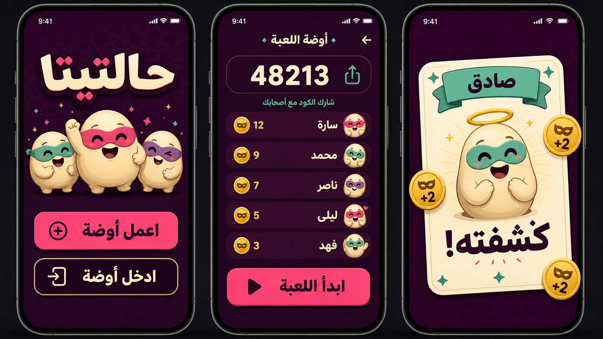
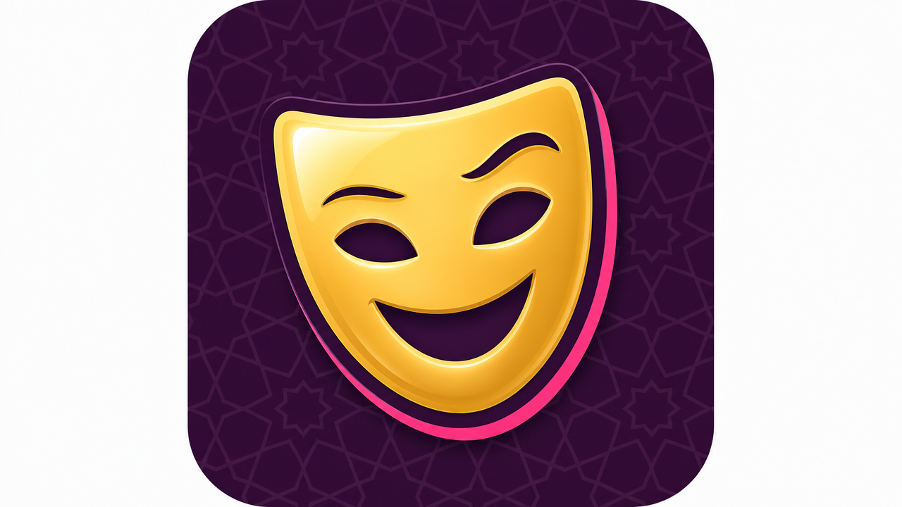
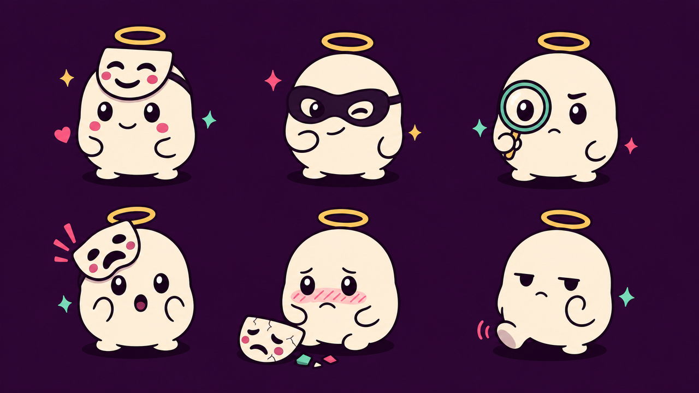

# Design system: حالتيتا

> **Status:** v3.0 · **Last updated:** 2026-10-03
> **Identity:** a masquerade game night. A deep plum background, cream cards, candy accents, and a cast of little masked characters. Players collect **masks 🎭**. Every UI value must come from the tokens in this file (`src/theme`). Don't use ad-hoc colours, sizes or fonts.
> **Brand rule:** none of the old print edition's motifs are used (no sugar cubes, no "حلو"/"الأحلى", no "Sweet & Liar").

---

## 1. Personality

- **Mischievous, theatrical, warm.** "Everyone's wearing a mask tonight."
- **Readable at a glance:** each phone shows one clear thing to do right now.
- **Drama at the right moments:** reveals, flips and results get motion and sound. Everything else stays calm.
- **In sync:** shared moments (the reveal, the results) animate at the same time on every phone, so the table reacts together.

## 2. Colour

### 2.1 Palette tokens (`theme/colors.ts`)

| Token | Hex | Role |
|---|---|---|
| `plum900` | `#2E0F35` | App background, primary text on light surfaces |
| `plum700` | `#4A1850` | Raised surfaces on dark backgrounds, sheets, mission cards |
| `cream` | `#FFF3E2` | Card faces, light surfaces, primary text on dark backgrounds |
| `pink` | `#FF4F8B` | **Primary accent**: primary buttons, liar (كداب) |
| `pinkDeep` | `#B81F55` | Pink **text** on cream |
| `mint` | `#6FDDBF` | Truth accent on dark backgrounds (صادق), success, "connected" |
| `teal` | `#1F7A6B` | Truth card band, mission card back |
| `gold` | `#F7B538` | **Mask token**, challenge cards, winner, host crown |
| `mutedOnDark` | `#B9A3BE` | Secondary text on plum |
| `mutedOnLight` | `#6E5A72` | Secondary text on cream |
| `white` | `#FFFFFF` | Text on teal only |

### 2.2 Semantic mapping

| Meaning | Colour |
|---|---|
| Question card (سؤال) | band `plum900`, face `cream` |
| Truth card (صادق) | band `teal`, accent `mint` |
| Liar card (كداب) | band `pink`, band text `plum900` |
| Challenge card (حُكم) | band `gold`, text `plum900` |
| Mission card (مهمة سرية) | band `plum700`, back `teal` |
| Masks gained | `gold` number with a `mint` "+2" |
| Masks lost | `pink` "−1" |
| Host-only controls | `gold` outline, crown icon |
| Connected / disconnected | `mint` dot / `mutedOnDark` dot plus a "فصل" (disconnected) label |
| Destructive (close room, end game) | `pink` outline button; never a filled red |

### 2.3 Contrast (checked; WCAG AA needs ≥ 4.5 for body text)

| Pair | Ratio | Use |
|---|---|---|
| cream on plum900 | 15.5 | ✅ everything |
| mint on plum900 | 10.3 | ✅ everything |
| gold on plum900 | 9.4 | ✅ everything |
| plum900 on gold | 9.4 | ✅ challenge cards, token numbers |
| pink on plum900 | 5.5 | ✅ text and accents |
| plum900 on pink | 5.5 | ✅ **text on pink buttons** |
| white on teal | 5.2 | ✅ truth band |
| pinkDeep on cream | 5.7 | ✅ pink text on cards |
| white on pink | 3.1 | ⚠️ large bold text only; prefer plum900 |
| pink on cream | 2.8 | ❌ never for text |

### 2.4 Background

- Default: `plum900` with a subtle **geometric star-lattice pattern** (SVG tile, cream stroke at 8% opacity), scattered with a few tiny mask outlines at 5% opacity.
- There's no light theme. It's always a night-time masquerade, and the cream cards provide the light surfaces.

## 3. Typography

| Role | Font | Notes |
|---|---|---|
| Display (logo, titles, card headers, reveals, token numbers) | **Lalezar** 400 | Arabic display face |
| Body and UI | **Cairo** 400 / 600 / 800 | Arabic and Latin in one family |

| Token | Font | Size / line height (sp) | Use |
|---|---|---|---|
| `hero` | Lalezar | 64 / 72 | The "حالتيتا" wordmark, winner name |
| `display` | Lalezar | 40 / 48 | Phase titles ("مين الصادق؟"), card type header |
| `code` | Lalezar | 56 / 64, letter-spacing 6 | Room code |
| `title` | Lalezar | 28 / 36 | Screen titles, player names in hero spots |
| `cardMain` | Cairo 800 | 24 / 36 | Question and answer text on cards (auto-shrinks to 18) |
| `bodyLg` | Cairo 600 | 18 / 28 | Instructions, buttons |
| `body` | Cairo 400 | 16 / 24 | Rules, lists |
| `cardSub` | Cairo 400 | 13 / 18 | English line on cards |
| `caption` | Cairo 600 | 12 / 16 | Chips, round counter, status |

- Arabic line height is never less than **1.4×** the size for Cairo.
- Card text auto-fits from `cardMain` down to 18; if it still doesn't fit, it scrolls inside the card. Never truncate.
- There are no all-caps labels. Don't emphasise single words with a different colour in headings.

## 4. Spacing, radius, elevation

- **Spacing (4-pt):** `xs 4 · sm 8 · md 12 · lg 16 · xl 24 · 2xl 32 · 3xl 48`
- **Screen padding:** 16 horizontal; 24 top below the safe area.
- **Radius:** `sm 8` (chips) · `md 14` (buttons, inputs) · `lg 20` (cards, sheets) · `pill 999`.
- **Elevation:** flat and graphic. A single "sticker" shadow on cards only: offset y = 6, no blur, `pink` on the hero card and `#00000040` elsewhere.
- **Cards** use the playing-card ratio **63:88**, about 82% of the screen width.

## 5. Components

| Component | Spec |
|---|---|
| **Button, primary** | Fill `pink`, text `plum900` Cairo 800 18, height 56, radius `md`, full width in the footer; pressed = scale 0.97 + light haptic; disabled = 40% opacity with the reason shown as a caption above it |
| **Button, secondary** | Transparent, 2 px `cream` border, `cream` text |
| **Button, host** | Transparent, 2 px `gold` border, `gold` text + crown icon. Visible only on the host's phone |
| **Button, ghost** | Text only, `mutedOnDark` |
| **CodeDisplay** | Room code in `code` style inside a `plum700` pill, with "شارك الكود" (share the code) and copy icons. Always Western digits |
| **CodeInput** | 5 separate digit boxes, numeric keypad, auto-advance, paste support |
| **GameCard** | 63:88. Coloured band on top (Lalezar header plus a small English label), `cream` face, inner frame line at 15% plum, centred content, dashed-divider footer hint. Variants: `question`, `truth`, `liar`, `challenge`, `mission`. The back uses the type colour, pattern, emblem and name |
| **HoldToReveal** | Face-down card with "دوس مطوّل عشان تشوف" and a pulsing ring. Flips face-up (250 ms) while held; hides **instantly** on release, on app background, or on blur. After the first reveal: primary "جاهز" |
| **PlayerChip** | Pill: small mascot avatar (tinted per seat), name, MaskCount. Badges: 👑 host, 🔍 guesser, ✓ ready, −1 penalised, grey dot + "فصل" disconnected |
| **MaskCount** | Gold mask token plus a Lalezar number; count-up animation with a floating "+2" or "−1" |
| **ReadyProgress** | "٣ من ٥ جاهزين" plus a row of chip dots filling in `mint` |
| **TimerRing** | Synced countdown: `mint` → `gold` at 10 s → `pink` at 5 s; ticks in the last 5 s |
| **HostControls** | A sticky bottom bar on the host's phone only: the phase's host action ("التالي", "ابدأ الجولة", …) plus the pause sheet icon |
| **Banner** | Top, full width. Offline: `plum700` + spinner "بنحاول نرجّعك…". Host away: a `gold` border overlay "المضيف فصل.. مستنيينه" |
| **Sheet** | Bottom sheet in `plum700`: pause (scoreboard, rules, and for the host, "إنهاء اللعبة") |
| **Toast** | Top, `cream` background, `plum900` text, 2.5 s |
| **PunishmentPicker** | A grid of 15 built-in chips plus a "عقاب من عندنا" (our own punishment) chip that opens a text field (1–80 chars). The selected one shows as a big locked card with 🔒 after Start |

### 5.1 Mascots and token (`components/art`)

- **Masky characters:** round, soft "bean" characters in cream with plum outlines, each wearing a **theatre mask**. Faces are drawn in SVG, and there are 8 seat tints for the mask colour.

| Pose | Used for |
|---|---|
| `honest`: mask lifted up on the forehead, smile, gold halo | Truth (صادق), winner |
| `sly`: black eye-mask on, smirk | Liar (كداب) |
| `detective`: magnifying glass, one raised brow | Guesser, "who's telling the truth?" |
| `shock`: mask half fallen, O-mouth | Guesser fooled |
| `exposed`: mask cracked on the floor, blushing | المكشوف (loser) |
| `wait`: tapping foot | Waiting states |

- **MaskToken:** a gold comedy mask (a simple face shape with two eye holes and a smile), used as the point icon everywhere.

## 6. Screen blueprints

| Screen | Layout (top → bottom) |
|---|---|
| **Home** | Pattern background · "حالتيتا" hero wordmark (cream with a pink offset shadow) · tagline "اكدب.. بس بذكاء" · 3 Masky characters · primary "اعمل أوضة" (create a room) · secondary "ادخل أوضة" (join a room) · (if one exists) "ارجع للأوضة {code}" · secondary "جرّب لوحدك" (solo demo) · ghost links: طريقة اللعب · الإعدادات · عن اللعبة |
| **Create** | "اسمك إيه؟" · name field · primary "اعمل الأوضة" |
| **Join** | CodeInput · name field · primary "ادخل" · inline errors |
| **Lobby** (everyone) | CodeDisplay · live player list (4–8, drag to reorder on the host's phone = seating order) · settings summary · locked punishment card · status "مستنيين المضيف يبدأ" |
| **Lobby** (host extras) | Rounds and timer segmented controls · missions toggle · PunishmentPicker · primary "ابدأ اللعبة" (disabled with a reason until valid) |
| **Lobby** (host kick) | Long-press a player chip → "اطلع برّه" (remove from room) with a confirm sheet (lobby only) |
| **Solo demo** | Same phase screens as an online game; a gold "تجربة" (demo) chip in the header; bots appear as tinted Masky chips |
| **Settings / About** | Settings: language, sound, haptics, family mode, "امسح بياناتي" (reset my data, with a confirm). About: version and build, privacy policy, support |
| **Round intro** | "الجولة ٣ من ٨" · detective mascot · "المخمن" + big name (on the guesser's own phone: "إنت المخمن!") |
| **Challenge** | Card back flips to the gold challenge card on every phone at once · "الكل يلتزم بالحكم ده" |
| **Question** | Question card · guesser's phone: "اقرا السؤال بصوت عالي" |
| **Secret role** | Answering players: HoldToReveal (truth card with the answer, or liar card) → "جاهز". Guesser: wait mascot + ReadyProgress |
| **Answering** | Answer order list with the current speaker highlighted · host: a "كسر الحكم −١" toggle per player · guesser: reminder "تقدر تسأل سؤالين" |
| **Guess** | Guesser: "مين الصادق؟" + a grid of big player buttons + a confirm sheet. Others: detective mascot "{name} بيختار…" |
| **Reveal** (synced) | 1.2 s drumroll · the picked player's card flips: honest mascot "كشفته!" or sly mascot "ضحك عليك!" · truth-holder highlighted · real answer on the truth card · mask deltas animate |
| **Results** | Winner: honest mascot with a halo and gold confetti, "سيد الأقنعة: {name}" · loser: exposed mascot "المكشوف: {name}" + the punishment card · full ranking · host: "العب تاني" / "اقفل الأوضة" |

## 7. Motion, haptics, sound

| Moment | Motion | Haptic | Sound |
|---|---|---|---|
| Button press | scale 0.97, 90 ms | light | none |
| Player joins the lobby | chip slides in, 250 ms | light (host only) | soft pop |
| Card flip | rotateY 180°, 350 ms | medium at the midpoint | flip |
| Hold to reveal, show / hide | 250 ms / **0 ms** | light / none | none |
| Timer last 5 s | ring pulse | tick | tick |
| Reveal: caught | honest mascot spring pop, mint burst | success | "ding" |
| Reveal: fooled | sly mascot slides in, pink burst | warning | cheeky laugh |
| Mask gain / loss | token count-up + floating delta | light | clink |
| Winner | gold confetti, 1.5 s | success | short fanfare |

- Shared moments start from the same database update, so they play within about 1 s on every phone.
- Respect the OS **Reduce Motion** setting: use fades instead of flips and bursts. Sound and haptics can each be turned off.

## 8. Voice and microcopy (Egyptian colloquial, playful)

| Situation | Arabic | English UI |
|---|---|---|
| Create / join | اعمل أوضة / ادخل أوضة | Create room / Join room |
| Share code | شارك الكود مع صحابك | Share the code with friends |
| Waiting in lobby | مستنيين المضيف يبدأ… | Waiting for the host to start… |
| Wrong code | الكود ده مش موجود | That code doesn't exist |
| Room full / started | الأوضة مليانة / اللعبة بدأت خلاص | Room is full / Game already started |
| Hold to reveal | دوس مطوّل عشان تشوف كارتك | Press and hold to see your card |
| Ready | جاهز | Ready |
| You're the guesser | إنت المخمن! | You're the guesser! |
| Guess title | مين الصادق؟ | Who's telling the truth? |
| Caught | كشفته! | Caught them! |
| Fooled | ضحك عليك! | You got fooled! |
| Winner | سيد الأقنعة: {name} 🎭 | Master of Masks: {name} 🎭 |
| Loser | المكشوف: {name}.. العقاب مستنيك | Exposed: {name}, your punishment awaits |
| Offline | بنحاول نرجّعك… | Reconnecting… |
| Host away | المضيف فصل.. مستنيينه | The host disconnected, waiting… |
| Punishment locked | العقاب اتقفل 🔒 | Punishment locked 🔒 |
| Server at capacity | السيرفر زحمة.. جرب كمان دقيقة | Server is busy, try again in a minute |
| Throttled | بالراحة شوية 🙂 | Easy there 🙂 |
| Solo demo | جرّب لوحدك | Try it solo |
| Removed from room | المضيف طلّعك من الأوضة | The host removed you from the room |
| Name not allowed | الاسم ده مش مسموح | That name isn't allowed |

## 9. Accessibility and ergonomics

- Touch targets ≥ 48 dp. Primary actions sit in the bottom third of the screen.
- `accessibilityLabel` on every control. Cards expose their full text to screen readers.
- Font scaling is allowed, capped at 1.3× on cards.
- The layout mirrors fully in RTL; directional icons flip.
- Never rely on colour alone: truth and liar always show their word (صادق / كداب) and a mascot pose too.

## 10. App icon and splash

- **Icon:** the gold MaskToken on a `plum900` rounded square with the pattern. No text.
- **Splash:** `plum900`, the "حالتيتا" wordmark in Lalezar (cream with a pink offset shadow), and the tagline underneath.

## 11. Visual references

These images are **mood references**. If an image disagrees with a token or spec in this file, the file wins. Arabic text inside AI images may be imperfect; use the real strings from `src/i18n`.

| File | Shows | Use it for |
|---|---|---|
| `assets/icon-concept.png` | Gold comedy-mask token on plum, pink sticker shadow | App icon (T-100), `MaskToken` (T-015). Crop to a square before use |
| `assets/masky-poses.png` | The six Masky poses: honest, sly, detective, shock, exposed, wait | `Masky.tsx` shapes and proportions (T-015) |
| `assets/mockup-screens.png` | Home, Lobby and Reveal screens | Layout, hierarchy and mood for T-042, T-068 and Home |
| `assets/cards-concept.png` | *(not generated yet)* The five card types | `GameCard` variants (T-061) |

- Rebuild the art in **SVG** (`react-native-svg`) from these references. Don't ship the PNGs inside the app; they are for design reference only.
